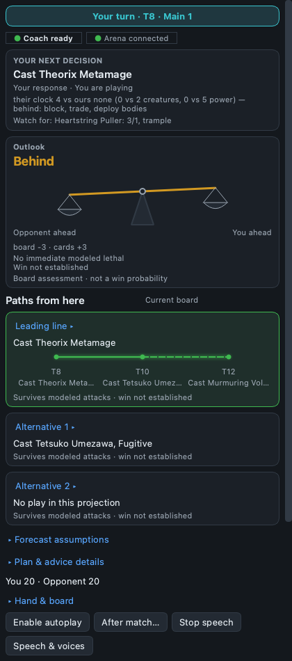

# MTGA Coach

MTGA Coach is a desktop companion for **Magic: The Gathering Arena**. Keep it beside Arena to see your next decision, compare possible lines, and hear advice or a two-person broadcast as you play. It reads Arena’s game log, helps with draft picks, and prepares a playbook for your deck before a match.

[Download Coach](https://mtgacoach.com/#get-started) · [Installation guide](INSTALL.md) · [Using the 4.0 screen](docs/using-coach.md)

## A clearer view of your next play

The **4.0 series** puts the current decision first. A glowing green path marks the leading supported line found by the search. An animated balance scale shows the board outlook, with the reasons underneath. Expand alternatives, your hand and board, activity history, or rank when you need them; autoplay and speech controls stay visible as you scroll.

<p align="center">
  
</p>

*Native desktop screenshot using the recorded `G1_T8` test fixture, not a live match. The outlook is Behind even though one path leads the search: green means best supported candidate found, not a guaranteed win. This still image does not show the scale’s animation.*

The scale is a board assessment, **not a win probability**. Paths show modeled continuations and their limits; unknown opponent spells and future draws are not predicted. When the board changes, old guidance loses its leading highlight while Coach reassesses. [Read the screen](docs/using-coach.md#read-the-screen).

## Install Coach

**New trial users should use the [desktop download page](https://mtgacoach.com/#get-started).** These downloads follow tested builds from `master`. Choose Windows x64 Setup, the Apple Silicon Mac package, or the Linux x64 AppImage. On Linux, make the AppImage executable before opening it.

If you prefer **stable**, install the package for your platform from the stable feed. The Windows installer attached to the latest official release also follows stable. Master and stable use the same 4.0.x version when the same build is promoted. The initial Windows and Mac packages are unsigned. [Stable downloads](https://github.com/josharmour/mtgacoach/releases/tag/coach-stable-feed) · [Latest official release](https://github.com/josharmour/mtgacoach/releases/latest)

### If macOS says the package was “Not Opened”

The current Mac installers are unsigned and unnotarized. Gatekeeper can block the first open with a message that Apple could not verify the package. To verify your download, run `shasum -a 256` on the downloaded `.pkg` and compare it with the SHA-256 digest for that exact asset on the GitHub release. If the digests match and you trust the package, click **Done**, open **System Settings → Privacy & Security**, scroll to **Security**, and choose **Open Anyway** for that package. [Tested-master release assets](https://github.com/josharmour/mtgacoach/releases/tag/coach-master-feed) · [Apple’s instructions](https://support.apple.com/en-us/102445)

### First run

1. In Arena, open **Options → Account**, turn on **Detailed Logs (Plugin Support)**, and restart Arena.
2. Open the newly installed **MTGA Coach** app. Choose **Tools → Setup & Repair**. This checks the Arena installation, logging, and license. Use **Check & Repair** to run the checks again.
3. For a seven-day trial, enter your email and the verification code sent to it. If you already have a subscriber key, enter it in Setup & Repair. [Subscriber key and account access](https://mtgacoach.com/subscribe)

Coach uses the hosted model `current` at `https://api.mtgacoach.com/v1`. Trial and subscriber installations need no Ollama server, separate Python installation, or environment file.

### How updates work

Coach checks its channel at launch and downloads an update in the background. A compatible update can apply after the match and its post-match work finish, or on the next launch. For a runtime or Arena bridge change, expand **Help & settings** and click **Update** beside **Restart Coach** after your match. macOS may ask for permission to replace the app. The title bar shows the channel, package build, and Git commit.

If you used the older Windows installer, pip, or a Git checkout, close the old copy and install the managed app once. Start it from the new shortcut. Coach uses your existing per-user settings and trial credentials. [Installation, update, and release guide](RELEASE.md)

## Coaching, speech, and autoplay

- **Live coaching** recommends plays using the board, your hand, and the choices Arena offers. A cached deck playbook gives Coach a starting point. During a match, it revises the plan as threats change while tactical advice can proceed.
- **Draft assistance** uses 17Lands ratings and color-pair information to explain picks and alternatives.
- **Speech & voices** offers Coach advice or two ArenaOnAir announcers, with **Hype** and **Technical** broadcast styles. Preview a voice or pair before saving. Choose Kokoro or hosted Chatterbox; Chatterbox uses your Coach sign-in and needs no local Torch installation or model download. Managed packages include the commentary core. [Speech controls](docs/using-coach.md#choose-what-you-hear).
- **Autoplay** plays the current match when enabled. **After match…** groups Auto Queue and Grind separately, so you can choose whether to continue after this game. Manual coaching reads Arena’s log; autoplay also needs a connected platform bridge.
- **Managed setup** includes Python and the bridge assets. Windows and Linux/Proton use BepInEx and the packaged plugin. Apple Silicon Mac packages include the native bridge; Coach stages it while Arena is closed and launches Arena with it. Source installs have separate bridge build steps. [Platform setup and first launch](INSTALL.md#platform-setup).

Coach can miss card interactions or suggest a suboptimal line. You can keep autoplay off and use spoken advice while making the decisions yourself.

## Run from source

The Python package includes the desktop app and an MCP server that exposes Arena game state to MCP clients. For the full development setup, including generated ArenaOnAir commentary, use Python 3.11. The base package supports Python 3.10 or newer. The following example creates a Python 3.11 environment in a fresh checkout using `uv`.

```sh
git clone https://github.com/josharmour/mtgacoach.git
cd mtgacoach
uv venv --python 3.11
uv pip install --python .venv -e ".[full]"
uv run --no-sync mtgacoach-desktop
```

See the [development workflow](DEV.md) for the local Python Dev launchers, **Copy commit**, tests, and the additional commentary-core installation needed by source users. The [feature documentation index](docs/README.md) covers subsystem guides and active work. A source checkout follows the Git revision you select. Python package users can also install the `arenamcp` wheel attached to a numbered release and launch `mtgacoach-desktop`. For desktop updates through Velopack, use a managed download above.

## License

The `arenamcp` package declares the MIT license.
