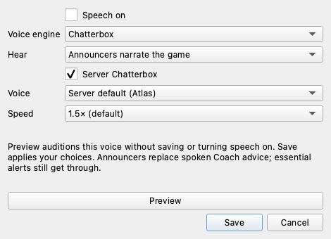

# AOA integration implementation and acceptance

Worktree: `/Users/joshu/repos/mtgacoach-aoa` (`/Volumes/repos/mtgacoach-aoa`).
Branch: `codex/aoa-integration`. Baseline: `7619a50fd5864352da8838e118a6471702bd41ae`.
The initial contracts/remote-provider commit was `2632102944c6ac2fad2efd6e26b4a1e53933f2d0`.
The original integration was merged and rolled out. The speech repair below supersedes
the original configuration UI and voice-routing choices; live settings and history
are preserved during rollout.

## Implementation checklist

| Plan requirement | Implementation | Verification / qualification |
|---|---|---|
| Versioned observations, evidence, epochs and delivery | `commentary/contracts.py`, `events.py`, `observations.py`; bounded 128-event GRE journal in GameState, copied through the published server snapshot | Replay tests cover transient casts/resolutions, stack disappearance, combat, life, turns, game boundaries, private/facedown cards and stable fingerprints |
| Observed outcomes, not submitted intentions | GRE `CastSpell`, `Resolve`, `PlayLand` annotations remain separate; no inference of resolution from a missing stack object | Provenance tests; deterministic lines only use observed facts |
| Authoritative Coach ingestion | PipeAdapter hands published state to one background service; no second watcher, database reader, app or history writer | Real JSON worker tests and mocked service tests; worker bootstrap bypasses Coach's application initializer |
| Headless AOA logic and personas | `commentary/headless.py` wraps the independently installed/source AOA `GenerativeBooth`, `StoryModel`, personas, native validation and factual audit | All four personas and two-caster anchor/heard behavior tested against sibling AOA source; separate standalone test suite also exercised |
| Deterministic path and audited announcers | Grounded event calls need no AOA package/model. Generative mode uses Coach's existing backend and the actual AOA booth; short compact prompts retain native validators | Generation+audit, rejected audit, unsupported resolution and disabled repairs tested. Grounded mode deliberately speaks at most one event call; cast/style primarily affect the generative booth |
| One playback owner and speech priority | CoachSession routes speech through `CommentaryController` and `SpeechArbiter`: essential, ordered workflow, commentary, routine/ambient | Tests cover exclusive advice/announcer routing, terminal acknowledgments for suppressed workflows, essential preemption, one active/one pending, expiry, duplicate IDs, stale callbacks and dependent replies |
| Playback is the delivery boundary | Accepted/rendered does not count as heard; only started→finished updates the AOA ledger | Mocked TTS lifecycle and native AOA delivery tests |
| Freshness at every expensive boundary | Match/game and snapshot checks before generation/audit, after result, after synthesis and before playback; eight-second calls/fifteen-second analysis; mode changes clear optional work | Fact-change, mode-change, epoch, stale-render and mute tests. Invalidation is conservative: a changed public snapshot can choose silence |
| Exclusive speech content | Announcer mode suppresses normal Coach workflow/routine/ambient audio while preserving UI text and completion acknowledgments; essential alerts remain eligible with the selected engine | Mode-switch, suppression, provider and workflow-completion tests |
| Immediate mute/mode controls | One visible speech switch controls desktop playback; choosing announcers assigns Coach ownership; older internal configuration remains supported | Controller/service tests. The choice does not stop another process; turn standalone playback off yourself before assigning Coach ownership |
| Remote Chatterbox independent of commentary | Dedicated speech key file, no LLM/license credential fallback, bounded reads, redirect rejection, mono 24 kHz PCM→WAV, cancellation, no retries, explicit failure without switching engines; long advice is chunked and joined | Real server-default, Atlas and Mira audio rendered; transport/cancellation and desktop completion tests. Audible device acceptance remains pending |
| Optional local Turbo | Separate interpreter/process, hash-locked dependencies, immutable model revision, offline local load, cached Atlas/Mira conditioning, default voice, licensed assets, CPU/MPS/CUDA selection, failure containment | Mocked PCM/protocol validation; published wheel API inspected. No Torch/model loaded or downloaded. Actual speed, OOM/device behavior and audio are pending |
| Inference protection | One exchange/no backlog, default two/max four per minute, two calls, six-second total deadline, 6,000 input-token conservative bound/call, 512/256 output, 48,000/3,072 aggregate, twelve request-seconds/minute including cancelled calls | Budget tests, proxy nonwaiting/preemption tests, socket cancellation tests. Local scheduling cannot prove cross-application gateway enforcement |
| Gameplay and strategy remain independent | Proxy protects foreground/strategy calls, cancels commentary and rejects optional admission while protected; no strategy refresh or decision dependency introduced | Separate strategy, proxy and existing gameplay narration regressions |
| Controls and readiness | Speech on/off; Kokoro/Chatterbox; Coach advice/Announcers; Server Chatterbox; discovered Voice catalog and Preview. Existing ArenaOnAir setup is reused; runtime internals are hidden | Offscreen UI tests and visual review; actual server schema checked. Server default omits voice, ignoring old troubleshooting pairs. Preview never saves or unmutes normal speech |
| Telemetry | Proxy supplies first-token/request/token metrics; service logs observation age/admission/budget/drop reasons; controller logs queue/render/playback lifecycle timings; voice failure status is visible | No private text in added service/controller metrics. Native AOA logging stays on worker stderr, not standalone history |
| Packaging | Worker source and licensed assets included in PyInstaller spec; bootstrap works with an external Python interpreter, without requiring Coach's dependencies in the voice environment | Source/bootstrap smoke tests. Windows Python 3.11 runtime + 3.12 executable builds and OS playback require platform qualification |
| Controlled acceptance | `commentary/qualification.py` evaluates matched OFF/ON JSON measurements; explicit local benchmark under `runtime/chatterbox/` | Evaluator tests reject missing measurements or any failed gate. No fabricated performance results |

The plan proposed eventually locating the facade in `arenaonair.headless`. This
branch supplies the facade in Coach's isolated worker and imports AOA's existing
modules without copying the booth or editing the separate, active AOA checkout.
A shared/released headless package remains a future extraction; the complete
integrated path works with a compatible AOA source checkout today.

## Safe end-to-end test sequence

After ranked matches finish, close the old Coach instance before launching an
updated checkout. Never run two instances against the same game. After rollout,
use the existing **MTGA Coach.app** launcher as usual.

1. Open **Speech & voices** from the compact panel or Tools menu.
2. Choose **Kokoro** or **Chatterbox**. For the existing speech server, keep
   **Server Chatterbox** checked. Coach reads the existing ArenaOnAir configuration;
   no URL, key, command, or model entry is required in this dialog.
3. Leave **Voice → Server default** to let the server decide. This is different
   from the explicit **Chatterbox original voice**. Atlas and Mira are offered
   only after the server advertises them. **Preview** auditions the current
   unsaved choice, even while Speech is off, without changing saved preferences.
4. Choose **Coach advice** or **Announcers narrate the game**, turn **Speech on**,
   and Save. Announcers replace normal spoken advice; essential alerts still use
   the selected voice engine. A Chatterbox failure does not silently switch to
   Kokoro. Try Preview again or explicitly choose Kokoro.
5. In a nonranked test, check mute/stop, a mode switch mid-line, game boundaries,
   and dependent analyst replies. UI explanations remain available in either mode.
6. Local Chatterbox requires a separate installed runtime and model; it is not
   installed on the current Mac. The dialog explains this and offers Server
   Chatterbox/Kokoro. Developer setup remains in `runtime/chatterbox/README.md`.



### Speech repair verification (2026-10-29)

- Root cause: the Kokoro rendering worker inherited saved mute, so its warmup
  probe returned no audio and exited with status 1. It now renders independently
  of playback mute and does not persist per-utterance voice or speed changes.
- Actual installed Python 3.12 runtime, real Qt QProcess startup, real Kokoro
  synthesis and real server-default Chatterbox synthesis passed with a temporary
  muted profile. Audio was inspected as WAV (24 kHz), not played audibly.
- Server health reported hybrid ready; its actual OpenAPI schema advertises
  Atlas, Mira and original voice, with Atlas as the omitted-voice default.
  Explicit Atlas/Mira and omitted-voice requests generated valid PCM/WAV.
- Real long-advice qualification exposed four-second request timeouts with
  large chunks. Requests now contain at most 100 characters; a 464-character
  natural advice sample rendered in five requests (1.19–1.88 seconds each),
  producing 688,320 frames at 24 kHz in 8.52 seconds without playback.
- UI review uses synthetic preferences; no game screenshots or credentials are
  included. Live settings/history and the shared speech service are unchanged.
- Local Chatterbox installation/hardware qualification, Windows runtime and
  audible playback remain unverified. No new service or model was installed.

## Performance and deployment gates still to qualify

Code and isolated tests do not establish hardware or cross-application capacity.
Required live qualification remains: Windows/macOS/Linux playback and device
failures; Windows packaged runtimes; local CUDA/MPS/CPU (and ROCm if deployed),
memory/frame-time impact; speech-server performance under shared load; gateway
priority/admission across Coach, Sobriety Copilot, coding/Hermes and other clients;
and proof that upstream cancellation actually frees shared resources. No gateway
configuration, credentials or other application was changed. Announcers enable the audited booth. Local Chatterbox remains optional; choosing
a voice engine never changes the shared server default.

For each platform and shared-load condition, capture the same replay with
commentary off/on and strategy off/on. JSON input for the evaluator must include:

```json
{
  "replay": "stable-replay-id",
  "strategy": true,
  "load": "controlled-load-description",
  "platform": "platform-and-device",
  "decisions": [{"id": "decision-1", "seconds": 1.0, "timeout": false, "fallback": false}],
  "essential_start_seconds": [0.3],
  "preemption_seconds": [0.1],
  "stale_game_utterances": 0,
  "overlapping_utterances": 0,
  "upstream_cancellation_verified": false,
  "gateway_admission_verified": false
}
```

The schema example is **not a measurement**. Supply at least twenty matching
ordered decision IDs, actual speech measurements, and verified gateway flags.
Run `PYTHONPATH=src python -m arenamcp.commentary.qualification baseline.json commentary.json`.
It requires p95 decision latency within **both** 10% and 200 ms, no additional
timeouts/fallback actions, every measured essential start ≤1 s, preemption ≤250 ms,
zero stale/overlapping utterances, and both gateway checks. Missing data fails.

## Validation record

- Final combined integration, desktop, game-state, workflow, watchdog/concede,
  strategy and proxy regression suite: **348 passed** (61.43 seconds). This
  includes the new tests and the existing selected regression suites.
- Standalone AOA `test_llm_booth.py`, `test_speech_audio.py`, `test_tts_remote.py`:
  **77 passed**, with one third-party Starlette deprecation warning; no model or
  audio device used. Source checkout HEAD was `20d87e8c5034f247f551bef326a4ac4d7983eff9`
  plus its existing local state; it was read only.
- Tests use temporary state, offscreen Qt, no bytecode/cache writes in source,
  mock model/audio, and loopback mock servers on random ports where needed.
- Local dependency resolution completed and the published Chatterbox 0.1.7
  `from_local` API was verified by wheel inspection. Installation, weights,
  live speech server tests and hardware benchmarks were intentionally not run.

- Ruff passed for every changed Python module and test; `git diff --check` passed.
- `uv build --wheel --out-dir /tmp/aoa-wheel-check` succeeded using an isolated
  temporary build environment (the active Coach environment was not changed).
- Wheel inspection confirmed packaged bootstrap/worker/UI sources and both voice
  assets/license; no Torch/Chatterbox default dependency. The extracted wheel
  worker completed its JSON handshake under `python -S` (stdlib only).
- Offscreen settings preview: [dialog image](aoa-settings-preview.png).

- Final saved-mute follow-up: **21 passed** for pipe voice, desktop completion,
  and controller tests (13.21 seconds); includes a new persisted-mute regression.
  Affected files passed Ruff and the wheel was rebuilt.

## Settings validation follow-up (2026-10-29)

The screenshot's generic HTTP(S) endpoint warning is reproducible when the
unsaved provider selection is Chatterbox server and its URL is empty. The
persisted provider may still be Kokoro because validation precedes every write.
Kokoro does not validate an inactive Chatterbox endpoint. Save and Apply/Preview
share the same validation; selecting remote Chatterbox requires a URL and its
separate speech-key file even when autoplay speech is Action narration.

The dialog now explains missing remote configuration, selects the Runtime tab
and focuses the relevant field. Provider-specific fields and generative style/
cast controls are disabled when inactive, with visible setup guidance. Invalid
explicit commentary runtime/source paths and non-executable local Python files
are rejected before settings are written. Cancel remains side-effect free;
Save does not trigger voice preview. New offscreen tests cover these paths,
persisted choices on reopening, and a mocked worktree engine launch that pins
PYTHONPATH while retaining the normal shared runtime/single-instance location.

No running Coach, game, settings, models, or services were changed or launched.
These GUI source changes require a future full desktop launch to load; an engine
reload alone does not replace the dialog code. Live audio, remote speech service,
and generative backend behavior remain unverified. The ordinary and worktree
launches still share the user profile; do not run them concurrently.

Updated offscreen preview: [settings guidance](aoa-settings-validation.png).

Validation: the expanded selection completed with 99 passing tests, one Windows-
only skip, and one launch-fixture failure (missing repository marker). After
correcting that fixture, its targeted rerun passed: **100 selected tests passed
in total, one skipped**. Ruff and whitespace checks passed. The UI was rendered
and visually inspected offscreen; all controls and guidance fit at 570×640.


## Speech and current-gateway repair (2026-10-30)

Speech & voices now has one Speed choice, default **1.5×**, shared by advice,
announcers, and unsaved previews. Kokoro applies its synthesis speed and
Chatterbox applies its native tempo once; playback does not resample either.
The server default voice remains the default; old troubleshooting voice pairs
are not restored. Updated surface: [Speech & voices](images/aoa-simple-speech.png).

The silent-announcer regression occurred before TTS: analysis finished after a
snapshot changed, was discarded, and consumed the inference allowance. Protected
strategy work could also prevent every optional call. When optional analysis is
busy, unavailable, stale, or out of budget, the service can emit one short template
from observed public evidence, at most once per ten seconds. Verified cast,
resolution, and land-play facts survive unrelated board updates within a fifteen
second window; current-state analysis still requires its original snapshot.
Mode, mute, game boundaries, expiry, and delivery cancellation remain enforced.
Templates do not invent actions or send another model request. Audit remains
mandatory for generative commentary. Status distinguishes waiting for events,
queued speech, and grounded calls while analysis waits for capacity.

Uncategorized legacy speech is workflow advice, so it cannot bypass Announcers.
The pipe no longer emits a duplicate speech event after forwarding to its voice
adapter. A settings instance clears successfully saved dirty keys, preventing a
later voice save from restoring an obsolete advice/announcer selection written
by another process.

The authenticated hosted catalog exposes only `current`. Deadline-sensitive
current/DeepSeek decision and commentary requests disable reasoning explicitly;
background game-plan requests cap high effort to low. Explicit GLM models retain
their separated-reasoning workaround. Existing timeouts, cancellation and action
fallbacks remain. Server priority is sent only for an explicit capability or a
known legacy GLM endpoint; a moving alias alone does not establish support.

Local verification used the regular installed Python 3.12 runtime with temporary
settings, the real Kokoro QProcess worker, and the existing Chatterbox server.
Kokoro preview WAV duration changed from 2.597 s at 1× to 1.637 s at 1.5×;
server Chatterbox from 2.600 s to 1.784 s. A protected-gameplay replay produced
“Player 1 casts Bear”, reached server Chatterbox, survived an unrelated board
update, and completed the desktop delivery lifecycle. WAVs were inspected
silently: this does not establish audible output through the user's speakers.
Two bounded synthetic gateway requests produced valid expected JSON in 1.004 s
(decision) and 1.077 s (plan); these are smoke checks, not game-quality or p95
latency qualification. Local Chatterbox synthesis is unavailable on this machine;
its native-rate transport is tested with a fake engine. No large runtime/model
installation, shared-server changes, or live game actions were performed.

Activation requires closing the regular desktop Coach after the current match;
engine reload alone does not update the desktop controller or dialog. Preserve
normal launcher and profile, then use Speech & voices → Chatterbox → Server
Chatterbox → Announcers narrate the game → Speed 1.5×. Preview auditions the
selected voice without changing mute or saving settings. Save applies choices.

Validation for this repair: **398 affected-path tests passed** (395 combined
gateway/desktop/typed-decision tests plus three final regressions). Repository
Ruff checks and formatting passed for 802 Python files; whitespace checks passed.


## Two announcers and original styles (2026-10-30)

Announcers now routes play-by-play and color analysis to two distinct voices.
The simple dialog includes Style, Voices and a sequential two-voice Preview;
Coach advice keeps its independent single-voice choice. The four styles come
from ArenaOnAir's `personas.py`: Classic radio booth, Esports hype desk,
Test-match understatement and Pro Tour analysts (technical). Each supplies its
native generation instructions; the fast grounded path and Preview also use
style-specific wording. Style changes do not change the explicit 1.5× speed.
[Updated dialog](images/aoa-two-announcers.png).

Server automatic pairing omits the lead voice override, following the server's
advertised default, and selects a different advertised partner. The current
service advertises Atlas (default), Mira and original Chatterbox; it exposes no
pair-default API. Automatic currently means Server default (Atlas) + Mira.
Explicit Atlas + Mira and Mira + Atlas choices are available. Old troubleshooting
single-voice values do not silently become announcer-pair preferences. A server
without a usable default and distinct partner produces an actionable status.
Kokoro pairs the selected advice voice with a different supported voice.

Grounded casts, land plays and resolutions can produce a linked short exchange,
with the second speaker adding actor or recorded destination evidence. Sparse
evidence can still produce one line or silence; it cannot justify invented
analysis. Both utterances register as in flight, and the reply waits for actual
successful delivery of its anchor. Failed/cancelled speech, mode/mute changes,
game boundaries and expiry suppress dependent replies. The grounded path keeps
the existing ten-second admission interval and makes no model requests. Audited
generation retains the same two-call budget and gameplay protection.

The installed Python runtime and real Kokoro worker rendered both voices at
1.5× (24 kHz, 1.818/2.138 seconds). The existing Chatterbox server rendered both
Preview voices (1.762/2.083 seconds), protected-gameplay grounded exchanges, and
both outputs from the real audited worker with deterministic model responses.
All eight nonzero WAVs completed the desktop delivery lifecycle in order. Audio
was intercepted for silent inspection, so these checks do not establish human
audibility or perceptual voice quality. Live model output quality and local
Chatterbox hardware remain separate qualifications; no new model load was sent
to the gameplay gateway. The offscreen dialog was rendered and inspected; no
user settings, game state, mute or output device were changed.

Build boundary: the previous installed regular Coach was `ac60736`.
This change requires a full Coach quit after a match before activation; an engine
reload alone cannot replace the desktop dialog/controller. After activation,
select Announcers → Style → Voices → Preview, then Save. Preview auditions both
speakers without saving. The existing server choice and 1.5× speed persist.

Validation: **188 affected-path tests passed**, including native style context,
real worker protocol, pair sequencing/cancellation, settings persistence and
current-gateway reasoning regressions. Ruff lint/format passed for 804 files.


## Useful narration and fast-event recaps (2026-10-30)

Dense snapshots could exceed the commentary input budget before making a model
request. The bridge now selects complete relevant facts, prioritizes important
plays over routine recent events, and includes permitted hand information and
its card rules. The model uses a constrained two-role response format; schema
size counts against the unchanged 6,000-byte conservative input bound. Generation
and audit still share the same six-second exchange deadline and gameplay admission.

A bounded pool retains up to 32 recent events and coalesces four per exchange.
Audited historical recaps remain eligible for 30 seconds across phase changes;
current-position lines depend on the board/hand fingerprint, and timing-sensitive
predictions keep strict snapshot checks. Delayed events retain their original
turn and phase. Actually delivered fallback calls enter the heard ledger, allowing
later analysis without repeating the play call. Mode, privacy and game changes
clear the relevant queues and context. Backlog and inference limits stay bounded.

Routine land drops and generic resolution confirmations no longer generate
filler exchanges. A fallback call can be one natural sentence; a second voice
must add something useful. Generated analysis permits clearly labeled, grounded
possibilities about future plays, responses and risks. Unsupported hidden-card
claims and fabricated outcomes remain rejected. The existing Coach deck overview
can introduce the deck without another model request. The Announcers-only
**Discuss my hand and deck** checkbox controls the existing explicit privacy
setting; it never reveals the opponent's hidden hand. [Dialog](images/aoa-hand-and-deck.png).

Verification includes captured-state replay with deterministic model responses,
real worker protocol, fast-event and phase-transition regressions, delivery and
consent tests, offscreen dialog inspection, and bounded synthetic requests through
the real configured model gateway. Private captured reports were not transmitted.
No game, autoplay or audible preview was started. Real match narration quality
and audible delivery remain user qualifications after safe activation.

Local validation: 187 affected-path tests passed, followed by the final focused
**53-test regression selection passed** after the final prompt/schema changes. Lint and formatting cover 808
Python files. The real installed-runtime worker completed a synthetic two-voice
generation plus audit in 3.3 seconds. Earlier synthetic attempts exposed invalid
roles, length violations and unsupported derived numbers; the repair constrains
roles and supplies explicitly hypothetical, checked arithmetic only for printed
fixed player damage and recorded life. This does not establish a target or outcome.
Captured report replay remains local and uses deterministic model responses.


## Player names and natural handle pronunciation (2026-10-30)

Announcers now receive both players' public display names from room metadata,
keyed by seat and persisted in the match checkpoint. Snapshots and the desktop
pipe carry the mapping; new matches clear it. Old checkpoints can use an already
known opponent name but never invent the local player's name. Both native booth
facts and grounded fallback calls use the observed names. The Coach adapter
replaces AOA's policy of suppressing digit-bearing handles: names remain exact
through factual validation, and the desktop handles their speech pronunciation.
Coach advice retains its existing second-person wording.

Speech formatting is local, bounded and cached, and applies to known handles
only. It expands titles, separates CamelCase/underscores, reads numeric suffixes
as individual digits (zero as “oh”), and gives opaque consonant tags a word-like
approximation. It preserves readable syllables rather than reciting the alphabet.
For example, `mrpickle802` is spoken “Mister pickle eight oh two.” Written narration
retains the actual handle. Kokoro and Chatterbox share this formatting before
rendering; voice pairs, style, speed and queue arbitration remain unchanged.
Exact pronunciation of unfamiliar handles remains a best-effort reading.

New names are also scrubbed from anonymized match bundles when the original room
log is absent. Regression coverage includes both seat orders, late metadata,
checkpoint restore/reset, generated facts and audit, fallback calls, exact-only
speech replacements, both TTS routes, public-state propagation and anonymization.
No current match data is sent to a model for these checks, and no live settings
or active Coach source is changed during isolated validation.


## Protection windows and meaningful outcome commentary (2026-10-30)

The shield recognizer now includes group grants such as Heroic Intervention.
Hexproof defeats opposing targeting, including targeted exile; indestructible
only covers supported destruction/damage cases and never promises protection
from exile or planeswalker loyalty loss. Before accepting a typed pass, a narrow
guard checks the current priority window, opponent's top stack object, actual
target, and Arena's offered/payable cast options. It only substitutes an
unconditional group-protection instant with no extra mode/target/cost decision.
Other selected actions are unchanged. Local captured-window replay changed the
erroneous pass against Abstruse Appropriation into the offered Heroic cast.
This is not a general rules engine or a guarantee of the match outcome.

Long background game-plan calls no longer monopolize commentary admission.
One optional commentary request may overlap that background replan, but urgent
decisions and other protected work immediately cancel its socket. No gameplay
thread waits for the booth. Two useful exchanges per minute remain the default;
failed attempts retain their token/time charges, with at most four attempts,
12 request-seconds per minute and six seconds per exchange. Empty no-call polls
back off without spending model airtime. No server-wide limits were changed.

The journal now retains explicit public milling, counterspell and battlefield
exit outcomes, coalescing same-message/same-cause bursts. It keeps at most 12
public card identities per burst, with no hidden-card names. Significant outcomes
can be recapped for 60 seconds; ordinary events retain 30 seconds. Predictions
still require the original snapshot, and current-board analysis requires the
position fingerprint. Game endings outrank recaps. Published event records are
not mutated when a burst grows.

Grounded fallback can give the analyst a distinct factual contribution: public
cards milled, the creature spell a counter stopped, or the creatures remaining
after removal. Relevant pending-spell analysis is conditional and expires with
its snapshot. Generic land/resolution filler remains suppressed. Empty/rejected
worker results, bounded admission reasons and terminal speech delivery states
are recorded without copying model prompts or secret-bearing exception strings.

Verification includes the captured Ugin protection window, a local replay of 20
captured milling events into two per-player outcomes, real worker generation/audit
protocol with synthetic responses, and actual localhost socket preemption.
The report's bounded raw-GRE tail did not include the milling introduction; the
outcome replay uses its retained parsed events and captured public card identities.
Separate synthetic GRE annotation tests exercise the real parser path. No report
was sent to an external model and no audio or game was started. Real shared-GPU
latency and perceived narration quality still need observation after safe activation;
local mock-server timing does not qualify upstream cancellation or performance.
