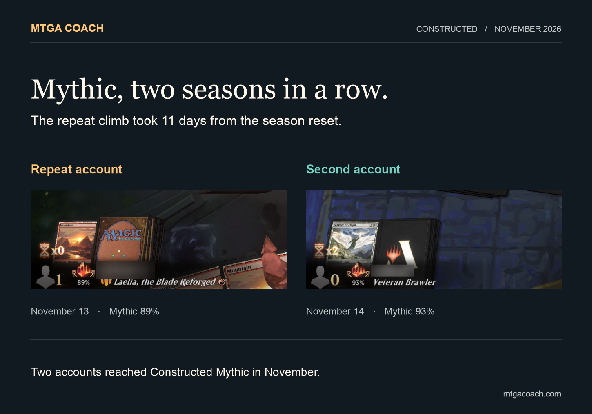
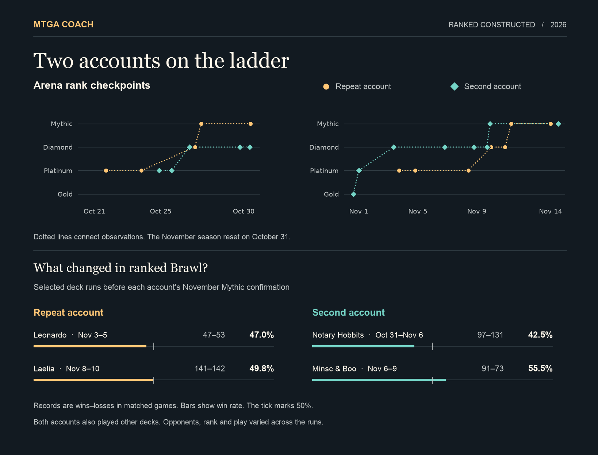

# Back to Mythic in 11 days

On October 27, Mono-Red Burn picked up win number 224 of my Arena season. That win moved my account from Diamond 1 to Constructed Mythic. I’d been using MTGA Coach along the way, and the badge came about 27 days after the season opened.

After the ladder reset, I wanted to see how quickly I could get back. On November 11, Mono-Red Burn won the promotion game again. This time the climb took about **11 days**. Those were busy days. Arena had counted 745 ranked matches on that account by the second promotion. My other account had already reached Mythic by November 9.

## The deck that changed the climb

The clearest example came from my second account. In ranked Brawl, The Notary Hobbits went **97–131** in the games I could match to that deck. With Minsc & Boo, the record was **91–73** through my first confirmed Mythic screenshot. That’s a swing from 34 more losses than wins to 18 more wins than losses, in the same queue.

On the repeat account, the story was different. Leonardo went 47–53, and Laelia went 141–142. Laelia got closer to even. Mono-Red Burn was the deck that closed the climb. The opponents and ranks changed along the way, so these records describe how each list performed during its run. They’re the numbers I’d want to see before spending more wildcards.

A Mythic push asks two things of me. I want a deck strong enough to give me winning lines, and I want expert-level decisions when those lines are hard to see. With a burn spell in hand, should it clear a blocker and buy two more attacks, or go upstairs and put the opponent one draw from lethal? Coach helps me think through that choice. If my list keeps running out of threats before either line works, I want to revisit the deck itself.

That’s where **Tools → Decks → Build a stronger deck** comes in. I can compare Standard lists with the cards I own, see which ones fit my wildcard balance, or paste a list I’m considering. Then I can bring the deck into Arena and use Coach to work on the decisions that make it worth playing.

## Draft and Sealed ask different questions

In a recent Bloomburrow draft, my black-green pool wanted Food for forage, and it still needed plays on turn two. In pack three, Coach recommended **Bakersbane Duo**. One pick filled both needs. That’s the kind of draft advice I want alongside the 17Lands ratings. By the third pack, the cards already in my pile can tell me more about the right pick than a rating alone.

In the November 14 Sealed Qualifier Play-In, the whole pool was in front of me at once. Coach compared color pairs and built a red-white deck with **23 spells and 17 lands**. One of its last cuts was a blue-red legend. Keeping the mana in two colors made it easier to cast early creatures on time and follow them with removal. Seeing the reason for that cut taught me more about the pool than seeing the final 40 alone.

Bring a deck you’re trying to climb with, or bring the next pack you open. [Try MTGA Coach](https://mtgacoach.com/#get-started)

## Short caption

My October Mythic climb took about 27 days from the season reset. In November, I got back in 11 with MTGA Coach. Mono-Red Burn won both promotion games. On my second account, switching Brawl decks made a bigger difference in the recorded results. The Notary Hobbits went 97–131. Minsc & Boo went 91–73, and that account reached Mythic too. [Try MTGA Coach](https://mtgacoach.com/#get-started)
